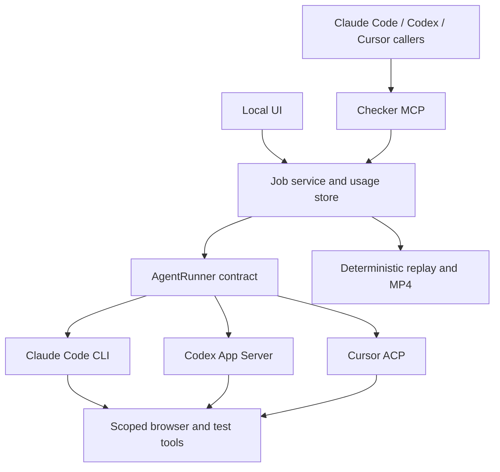

# Next milestone: measured runs and selectable agent runtimes

> Historical design baseline. See [implemented scope and verification](runtime-milestone.md) for current behavior, the T3-style UI, and the Cursor capability gate. Tables below describe the pre-implementation audit or proposed contract.

Date: 2026-10-12. Status: implementation proposal, based on the current source and live read-only probes. **Existing developer subscriptions first** is the selected authentication direction. This document and the [provider research](research/multi-provider-auth.md) describe work to build; they do not claim that Codex or Cursor verification is implemented.

## Recommendation

Build a measurable, cancellable verification job first, then plug Codex and Cursor into the same job pipeline. Keep the existing Explore → Codify → Replay architecture. A job-oriented MCP remains the public interface for Claude Code, Codex and Cursor. A small internal `AgentRunner` interface owns runtime differences; use ACP where it preserves the needed capabilities, and official native interfaces where they expose better controls or telemetry.

The closest reusable library is `@agentclientprotocol/sdk`. It standardizes communication with agents, including advertised authentication methods. It does not merge subscriptions or guarantee complete token accounting. Use it initially for Cursor's native `agent acp`; keep the working Claude Code CLI path and use Codex App Server for model discovery, usage and cancellation. An all-ACP implementation can replace these transports after parity tests, without changing the checker MCP. See the [source comparison](research/multi-provider-auth.md).

## What exists and what is missing

| Area                 | Verified current behavior                                                                                                            | Next change                                                                                                     |
| -------------------- | ------------------------------------------------------------------------------------------------------------------------------------ | --------------------------------------------------------------------------------------------------------------- |
| Pipeline             | Explore, codify, deterministic replay, captions and MP4 packaging work; known-good/known-broken 6003 pair is recorded in the results | Preserve that regression pair as the provider acceptance test                                                   |
| Run time             | UI displays `finishedAt - createdAt`; stage artifacts record `wallMs`                                                                | Separate queue, preparation, agent work, replay and packaging; persist accurate terminal timing                 |
| Token usage          | Claude `usage` is saved in explore/codify metrics; it is not summarized in jobs or the UI                                            | Normalize and show tokens, cache use, resolved models and completeness per stage and run                        |
| Dollar cost          | `sumCost()` adds explore/codify `costUsd`, defaults absent amounts to zero, and populates jobs only when verify returns              | Preserve partial costs on errors; distinguish reported model cost, an estimate and confirmed billed charges     |
| Model choice         | One global `config.model`, passed to `runClaude`; no per-job provider/model input in MCP or UI                                       | Persist an explicit target for each run; later allow different explore/codify targets                           |
| MCP                  | A real `tools/list` call returned `verify_case`, `get_job`, `list_jobs`, `attach_to_pr`; no output schemas                           | Add discovery, batched runs, cancellation, replay and structured outputs; `list_slots` is documented but absent |
| Reliability          | JSON job snapshot persists; restarts mark queued/running jobs failed; subprocess runner has no cancellation/deadline contract        | Typed states, append-only usage/events, cancellation, bounded timeouts, restart reconciliation                  |
| Parallelism          | Browsers and origins differ, but data uses the shared test user; several runs can share one worktree                                 | Lease test identities per concurrent mutating run or serialize those runs                                       |
| Verification quality | Reports are parsed with a TypeScript cast; some assertions are inferred; some Qase cases are stale                                   | Validate required steps and verdicts against the frozen case before accepting a report                          |
| Publish evidence     | `attach_to_pr` is implemented, but the results document says the publish path has not been exercised                                 | Test against one explicitly selected PR; keep publishing an explicit action                                     |

Source audit: [jobs](../src/jobs.ts), [Claude runner](../src/claude.ts), [verification](../src/verify.ts), [MCP](../src/mcp-server.ts), [UI](../src/app/client/App.tsx), [results](poc-results.md), [PoC plan](poc-plan.md). Also fix the stale `npm run verify` entry, which points to the absent `src/run-case.ts` instead of `src/verify.ts`.

## Subscription-first authentication

The app shows one connection card per runtime: installed version, authentication state/mode, model catalog, usage capabilities and the next native login action. Each provider owns credential storage and renewal. The checker never accepts a subscription token as an MCP argument or copies one into its own database.

| Runtime     | Initial integration                                | Authentication approach                                                                                                                                                                                                      |
| ----------- | -------------------------------------------------- | ---------------------------------------------------------------------------------------------------------------------------------------------------------------------------------------------------------------------------- |
| Claude Code | Unmodified `claude -p --output-format stream-json` | User signs in through Claude Code. Keep its existing restriction/tool policy. Anthropic explicitly distinguishes native end-user login from third-party credential routing; do not implement a custom Claude.ai OAuth proxy. |
| Codex       | Official App Server over local stdio               | Reuse Codex's ChatGPT account; use supported account APIs for status/login and `model/list` for discovery.                                                                                                                   |
| Cursor      | Native `agent acp` through ACP SDK                 | Reuse Cursor CLI authentication; expose its advertised login method and available models. Handle supported permission/extension requests explicitly.                                                                         |

Sources: [Claude credential rules](https://code.claude.com/docs/en/legal-and-compliance#authentication-and-credential-use), [Codex authentication](https://developers.openai.com/codex/auth), [Codex App Server](https://developers.openai.com/codex/app-server), [Cursor ACP](https://cursor.com/docs/cli/acp), [ACP authentication](https://agentclientprotocol.com/protocol/v1/authentication).

Default requested billing mode is `subscription`. Preflight must detect an effective API-key configuration and return `AUTH_MODE_MISMATCH` rather than silently starting separately billed work. An unknown mode remains unknown and cannot satisfy that strict preflight. Do not change a developer's global login, unset their environment globally, or fall back to another provider/model automatically. A future explicit API-key mode can be added through the same runner contract.

**Local evidence:** Claude Code 2.1.296 is logged in using `ANTHROPIC_API_KEY`; Codex 0.162.1 reports a ChatGPT account; Cursor 2026.10.01-e373342 reports authenticated. Thus the present Claude process environment does not meet the selected subscription-only preference. These probes did not change credentials. Cursor SDK is not the default integration because its own login creates a user API key rather than automatically adopting the CLI login; see [research](research/multi-provider-auth.md).

## What every run should show

Collapsed card: case, runtime, requested/resolved model, result, elapsed time, tokens and clearly labeled cost. Expanded card: stage table, input/output/cache breakdown, retries, tool calls, completeness, artifact links and existing player. Preserve the video DOM behavior from the playback fix.

Illustrative display, not measured benchmark data:

```text
DEMO-6003 · Codex · <resolved model> · Pass
4m 18s active · 12s queued · 143k tokens · $0.42 API-equivalent estimate
Billing mode: ChatGPT subscription · Billed amount: unavailable

Prepare    22s     no model calls
Explore    93s     92k tokens
Codify     61s     51k tokens
Replay     75s     no model calls
Package     7s     no model calls
```

Store the following, not just one ambiguous `costUsd`:

```ts
type RunUsage = {
  status: 'pending' | 'partial' | 'complete' | 'unavailable';
  inputTokens: number | null; // all input, including cached input
  outputTokens: number | null;
  totalTokens: number | null; // input + output, when both are known
  cacheReadTokens: number | null; // subset of input
  cacheWriteTokens: number | null; // subset of input where applicable
  reasoningTokens: number | null; // subset of output, if the runtime defines it that way
  providerReportedCostUsd: number | null;
  estimatedApiCostUsd: number | null;
  billedCostUsd: number | null;
  pricingSnapshotId: string | null;
  source: string; // runtime/version/event schema
};
```

Implementation rules:

1. Normalize each provider's definitions before aggregating. Claude's saved `input_tokens` excludes the cache-read and cache-creation counters; Codex input usage includes its cached-input subset. Never add the same cache count twice. Keep raw events for auditing.
2. ACP `usage_update.used` is **current context occupancy**, not the lifetime input-token total. Store context-window occupancy separately. Its optional cumulative cost also needs explicit provenance. [ACP prompt-turn specification](https://agentclientprotocol.com/protocol/v1/prompt-turn).
3. A subscription run consumes allowance, but a token-derived dollar amount is not proof of a cash charge. Display `billedCostUsd` only from a provider billing record attributable to this run. Unknown is `null`, never `$0.00`.
4. Deduplicate cumulative usage by session/turn/event identity; do not sum every cumulative snapshot. Preserve any usage recorded before failure or cancellation, marked partial when necessary. Include helper-model/subagent usage only when actually reported, without double-counting a parent's aggregate.
5. Persist both the requested model and every resolved model. Existing Claude artifacts sometimes include a helper model as well as the requested model. Avoid hard-coded catalogs; record when a catalog is stale or access is unverified.
6. Store `queuedAt`, `startedAt`, `finishedAt` and stage durations. Use a monotonic clock for durations in a live process. Stage timings are explicit events, not parsed from log text. Agent inference time is separate and optional; wall time must not be labeled inference time.
7. Reused exploration/spec artifacts have provenance, but their old token costs are not new spend. A replay-only run records no new model calls; fail clearly if the required spec is missing rather than silently invoking exploration.
8. Backfill old runs from available artifacts only. Historical queue/preparation timings that were not recorded remain unknown. Costs recorded by the old runner do not establish which auth mode was used historically.

## Model selection and comparisons

Select **runtime first, then model**, with reasoning options exposed only where supported. “Claude via Cursor” and “Claude Code” are separate targets. Stage-level overrides can later choose one model for exploration and another for codification; the initial UI uses one target for both.

Selecting three targets for two cases submits six independent jobs in one comparison group. Show the expansion before submission. Retrying a case creates a new run linked to the previous one. Idempotency keys prevent a repeated MCP request from creating the same six jobs twice.

Compare matched inputs: case revision/hash, worktree commit and dirty-tree fingerprint, prompt version, browser settings, target environment, identity/fixture lease and resolved runtime/model versions. For mutation-heavy cases, reset fixtures or run sequentially until isolation is proven. One identity per slot is insufficient when multiple jobs can use the same slot concurrently.

Do not rank models by speed/cost alone. Show verdict correctness on the known regression pair, observed versus inferred assertions, codification success, replay stability and cost. The existing results are a useful baseline, not a completed cross-provider benchmark.

## Implementation order

| Order | Deliverable                                                                                                      | Completion evidence                                                                                                                                              |
| ----- | ---------------------------------------------------------------------------------------------------------------- | ---------------------------------------------------------------------------------------------------------------------------------------------------------------- |
| 1     | Normalized usage + stage timing, persisted incrementally and displayed in UI/MCP; preserve old-run compatibility | Reconcile an existing run with raw metrics; test cache semantics, cumulative updates, missing/partial metrics and replay reuse; playback regression still passes |
| 2     | `AgentRunner`, provider preflight, effective auth mode, per-job target and dynamic model catalogs                | Existing Claude path still passes; authenticated discovery performs no inference and exposes no credentials                                                      |
| 3     | Codex App Server adapter, then Cursor ACP adapter                                                                | Each performs a browser MCP action, produces a schema-valid report, codifies/replays the known-good/known-broken pair and cancels cleanly                        |
| 4     | Batch selection, comparison groups, filters and replay from saved specs                                          | Case × target fan-out is correct; duplicate submissions reuse IDs; no mutation collision or double-counted reused cost                                           |
| 5     | Durable queue and resumable stage boundaries, limits and provider-rate-limit handling                            | Restart, timeout, cancellation, malformed stream, unavailable model and expired-login tests preserve state and partial usage                                     |
| 6     | Finish PoC acceptance and team readiness                                                                         | Dedicated test identities/disposable fixtures, backend-worktree test pair, one authorized evidence publish, spec export and stale Qase findings reviewed         |

Build cancellation/deadline propagation into the runner in step 2; step 5 strengthens persistence and recovery. Authentication failures, unsupported tools or model changes must never trigger silent fallback. Token and dollar limits are cooperative unless a provider enforces them; include any unavoidable in-flight overshoot in the final usage.

## Proposed MCP and module layout

The exact public operations, schemas and compatibility requirements are in [the MCP contract](mcp-contract.md).



Suggested modules: `src/agents/{types,claude,codex,cursor}.ts`, `src/usage/{normalize,aggregate}.ts`, `src/jobs/{service,store}.ts`, and shared schemas used by HTTP and MCP. Extract modules as these slices require them; avoid a wholesale rewrite.

The scoped browser/test tools should record action results independently of each agent's transcript format. Today `actionLog()` understands only Claude's message structure. A provider-neutral action recorder is necessary for Codex/Cursor codification to receive equivalent evidence. Tool permissions must enforce allowed paths/actions in each adapter, including file edits and test execution; prompts alone do not enforce the current restrictions.

## Live checks performed for this proposal

- Read-only Claude/Cursor auth status and installed versions; no credential values captured.
- Cursor ACP `initialize`: protocol 1 accepted; advertised `cursor_login`, image input, session loading and HTTP/SSE MCP capabilities. No prompt/session or paid inference was started.
- Codex App Server `initialize`, `account/read` and `model/list`: successful; ChatGPT account and seven picker models returned. A catalog is not proof that an inference request for every model will succeed.
- Actual checker MCP `tools/list`: four tools, no output schemas. No verification or GitHub publication invoked.
- Inspected existing stage metrics: raw token/cache counts and occasional multiple resolved Claude models are available for historical presentation.

Not yet verified: subscription-mode Claude execution in this environment, complete Cursor token/cost events over native ACP, cross-provider browser permission parity, provider cancellation during tool execution, or the full verification pipeline under Codex/Cursor.
